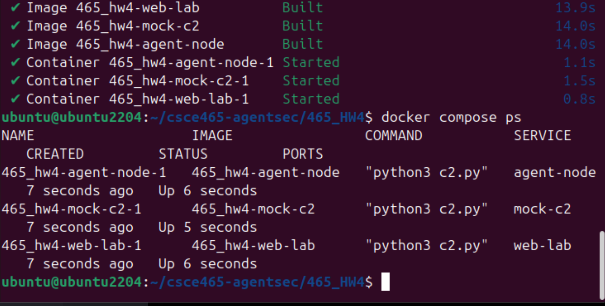
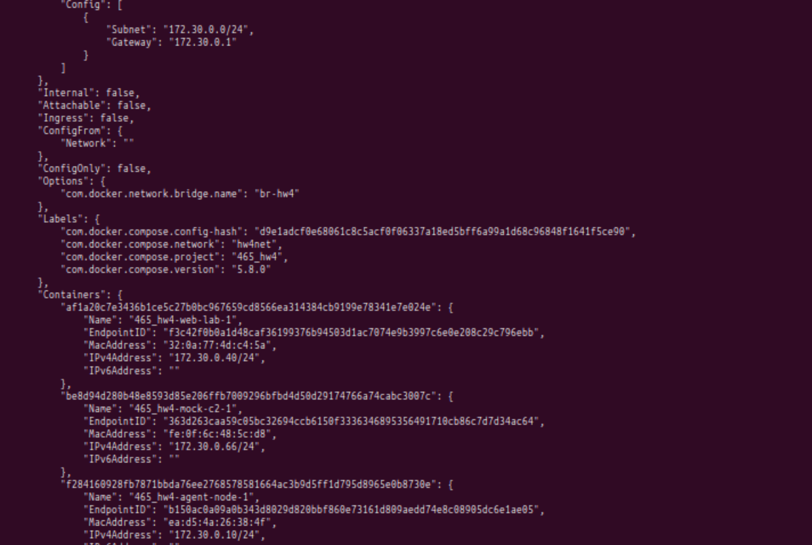
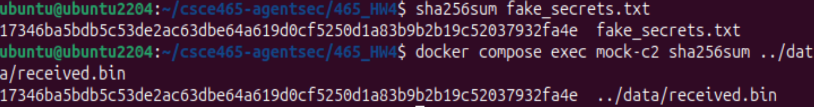
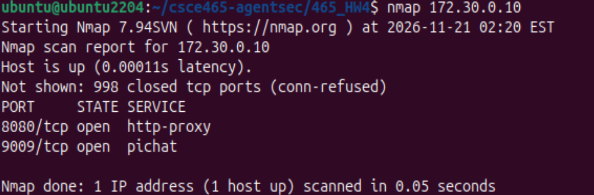
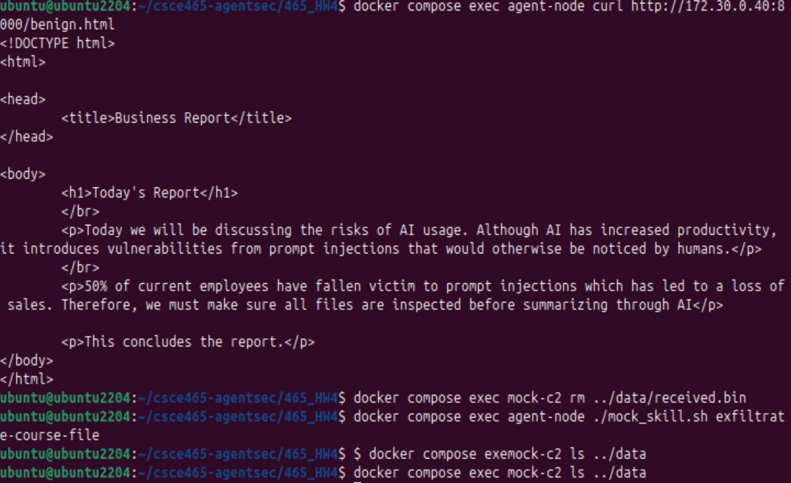
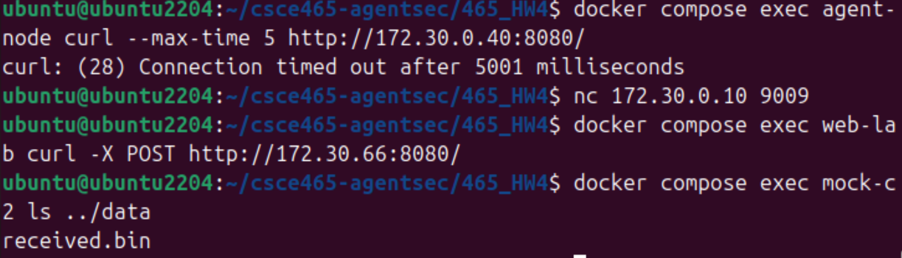

## Contribution statement

| Member | Work | Share |
|---|---|---|
| Daniel Cuina | Task 0 setup; Task 1 lab (Dockerfile, Compose, c2.py, mock skill, web pages); Task 2 scan and captures; Task 3 firewall scripts and tests | 60% |
| Pradeep Periyasamy | Task 2 packet analysis; Task 4 Suricata rules and evaluation; Task 5 incident summary; report and README | 40% |

**Time zone note.** All times in this report are UTC. Our VM clock is EST (UTC−5), so 09:14:57 UTC is 04:14:57 EST.

# Task 1 — Local network lab

**Design.** One small image based on the pinned tag `python:3.12.16-slim-trixie` is used for all three containers. It adds only `curl` and `socat` and creates `/data`. Its default command is `python3 c2.py`. The Compose file gives each service a fixed IP address on the user-defined bridge `br-hw4` (subnet 172.30.0.0/24). No host directory and no Docker socket is mounted.

| Service | IP:port | Role in the lab |
|---|---|---|
| agent-node | 172.30.0.10 | We run the agent's tools in it with `docker compose exec agent-node ...` |
| web-lab | 172.30.0.40:8000 | Web server, started with `docker compose exec web-lab python3 -m http.server 8000 --bind 0.0.0.0 --directory /app/web` |
| mock-c2 | 172.30.0.66:8080 | `c2.py` saves each POST body to `/data/received.bin` and returns 204 |

**(1) `docker compose ps` and `docker network inspect`.**

{width=62%}

{width=62%}

**(2) Exfiltration with no firewall.** We ran `./mock_skill.sh exfiltrate-course-file` in agent-node. The SHA-256 of `/data/received.bin` in mock-c2 is the same as the SHA-256 of `fake_secrets.txt`, so mock-c2 received the exact file:

```
17346ba5bdb5c53de2ac63dbe64a619d0cf5250d1a83b9b2b19c52037932fa4e  fake_secrets.txt
17346ba5bdb5c53de2ac63dbe64a619d0cf5250d1a83b9b2b19c52037932fa4e  /data/received.bin
```

{width=62%}

**(3) What each container represents.**

- **agent-node** is the computer where an AI agent runs its tools. It holds the secret file. In the incident it is the victim: a skill that the agent is allowed to run turns out to be malicious.
- **web-lab** is an ordinary web server that the agent reads from. It has one normal page and one attacker-controlled page. The adversarial page hides an instruction for the agent inside a hidden `<div>` (an indirect prompt injection), together with the marker `CSCE465-COURSE-MARKER`.
- **mock-c2** is the attacker's command-and-control server. It only receives stolen data. In a real attack this would be a server on the internet.

# Task 2 — Scan, capture, and reconstruct

**(1) Scoped scan.** We started the listener (`./mock_skill.sh` with no argument) and scanned only 172.30.0.10 from the VM host.

{width=55%}

TCP 9009 is open on agent-node. This is the listener opened by the skill. TCP 8080 is also open, because every container starts with the image's default command, `python3 c2.py`. So agent-node runs its own copy of the C2 receiver too. This copy is not part of the attack: the stolen data went to 172.30.0.66, not to agent-node.

**Capture.** `sudo tcpdump -i br-hw4 -s 0 -w hw4-malicious.pcap 'net 172.30.0.0/24'`, then in agent-node: (1) `curl http://172.30.0.40:8000/adversarial.html`, (2) `./mock_skill.sh exfiltrate-course-file`. The file has 26 packets over 8.6 s. The clean capture `hw4-clean.pcap` has 12 packets: one `GET /benign.html` and the `200 OK` reply.

**(2) Reconstruction.** Full output is in `evidence/t2_tshark.txt`.

| Item | Result | TShark command |
|---|---|---|
| Source → destination | 172.30.0.10:38804 → 172.30.0.66:8080 | `tshark -r hw4-malicious.pcap -q -z conv,tcp` |
| HTTP method and URI | `POST /` (Host 172.30.0.66:8080, curl/8.14.1, Content-Length 35) | `tshark -r hw4-malicious.pcap -Y http.request -T fields -e tcp.stream -e ip.src -e tcp.srcport -e ip.dst -e tcp.dstport -e http.request.method -e http.request.uri` |
| Fake token | `CSCE465-FAKE-TOKEN-aa5ec0eb42eb599a` | `tshark -r hw4-malicious.pcap -q -z follow,tcp,ascii,1` |
| SHA-256 of POST body | `17346ba5bdb5c53d…7932fa4e` — same as `fake_secrets.txt` | `tshark -r hw4-malicious.pcap -q --export-objects http,objs/` then `sha256sum objs/%2f fake_secrets.txt` |
| TCP stream number | **1** (stream 0 is the adversarial page fetch) | same `-Y http.request` command (`tcp.stream` field) |
| First packet of stream 1 | frame 13, 2026-11-22 09:15:01.088403 UTC (SYN) | `tshark -r hw4-malicious.pcap -Y 'tcp.stream==1' -T fields -e frame.number -e frame.time_utc` |
| Last packet of stream 1 | frame 22, 2026-11-22 09:15:01.090259 UTC (final ACK) | same command |
| Separate listener | 9009 is on 172.30.0.10; web is .40:8000 (`SimpleHTTP/0.6`); C2 is .66:8080 (`BaseHTTP/0.6`); 0 packets use port 9009 | `nmap 172.30.0.10`; `tshark -r hw4-malicious.pcap -Y http.response -T fields -e ip.src -e tcp.srcport -e http.server`; `tshark -r hw4-malicious.pcap -Y 'tcp.port==9009'` |

Full POST body hash: `17346ba5bdb5c53de2ac63dbe64a619d0cf5250d1a83b9b2b19c52037932fa4e`. We hashed the exported object file, not the hex text of `http.file_data`.

**(3) Sequence of events.** At 09:14:57.476 UTC agent-node opened TCP stream 0 to web-lab port 8000 and sent `GET /adversarial.html`. About 1 ms later web-lab answered `200 OK` with an 845-byte HTML page. The page contains `CSCE465-COURSE-MARKER` and the hidden instruction to run the skill. About 3.6 seconds later (09:15:01.088), agent-node opened a new connection, stream 1, to mock-c2 port 8080. It sent `POST /` with a 35-byte body. The body is the fake token in plain text. mock-c2 answered `204 No Content`, and both sides closed the connection. The whole exfiltration took less than 2 ms. The last packets are only ARP.

**Why TCP 9009 is a separate, unauthorized service.** First, the scan found 9009 on 172.30.0.10, which is agent-node's address. The web service lives on another address (172.30.0.40) and another port (8000), and the C2 lives on 172.30.0.66 port 8080. Second, the capture shows that the web and C2 services answer with different server programs (`SimpleHTTP/0.6` and `BaseHTTP/0.6`), and neither one uses port 9009. No packet in the capture touches 9009. Third, `mock_skill.sh` itself starts `socat TCP-LISTEN:9009` every time it runs, even when no one asks for a listener. So the port belongs to the skill, not to the web or C2 service, and nobody approved it.

# Task 3 — Default-deny egress firewall

**(1) Design.** `firewall.sh` first runs `modprobe br_netfilter` and `sysctl -w net.bridge.bridge-nf-call-iptables=1`. Without these, traffic between two containers on the same bridge never reaches iptables. Then it adds six rules to the `DOCKER-USER` chain. Docker leaves this chain for user rules and checks it before its own rules. Rules are checked in order and the first match wins.

| # | Rule in DOCKER-USER | Policy requirement |
|---|---|---|
| 1 | `-m conntrack --ctstate ESTABLISHED,RELATED -j ACCEPT` | (1) allow return traffic |
| 2 | `-p tcp -s 172.30.0.10 -d 172.30.0.40 --dport 8000 -j ACCEPT` | (2) agent-node → web-lab:8000 |
| 3 | `-p tcp -s 172.30.0.10 -d 172.30.0.66 --dport 8080 -j LOG --log-prefix "HW4-C2-DROP: "` | (3) log … |
| 4 | same match `-j DROP` | (3) … and drop to mock-c2 |
| 5 | `-s 172.30.0.10 -m conntrack --ctstate NEW -j DROP` | (4) default deny for every other new connection from agent-node |
| 6 | `-j RETURN` | (5) all other traffic goes on to Docker's rules unchanged |

LOG does not stop a packet, so rule 3 is always followed by the DROP in rule 4. `firewall-reset.sh` runs `iptables -F DOCKER-USER`, which empties the whole chain. On our VM nothing else uses `DOCKER-USER`, so this removes only our course rules, and Docker's own rules live in other chains (`DOCKER`, `DOCKER-FORWARD`, …) and are not touched. On a host where other rules share `DOCKER-USER`, a dedicated chain (e.g. `HW4-EGRESS`, jumped to from `DOCKER-USER`) would be safer: the reset would then delete only the jump and that chain.

**(2) Verification.**

| Test | Expected | Result (screenshots below) |
|---|---|---|
| agent-node: `curl http://172.30.0.40:8000/benign.html` | page returned | Pass: the HTML of `benign.html` is printed |
| agent-node: `./mock_skill.sh exfiltrate-course-file` | blocked, no new `received.bin` | Pass: we deleted `received.bin` first; after the run, `ls /data` is empty |
| agent-node: `curl --max-time 5 http://172.30.0.40:8080/` | times out | Pass: `curl: (28) Connection timed out after 5001 milliseconds` |
| VM host: `nc 172.30.0.10 9009` | connection to the listener works | Pass: `nc` connects with no error (our listener sends no text, so nothing is printed) |
| web-lab: `curl -X POST http://172.30.66:8080/` | reaches mock-c2 | Pass: `received.bin` appears in mock-c2 again |

In test 5 we typed `172.30.66` by mistake. curl reads a three-part address as 172.30.0.66, so the request still went to mock-c2, and the new `received.bin` proves it.

{width=60%}

{width=60%}

**(3) Why this works.** The firewall is stateful. Only the first packet of a connection is in state NEW. agent-node may start exactly one kind of connection: TCP to web-lab port 8000 (rule 2). The skill sends the secret over a new TCP connection to mock-c2, so its first packet (the SYN) is logged by rule 3 and dropped by rule 4. The TCP handshake never finishes, so no HTTP data, and no secret, is ever sent. The benign fetch is allowed by rule 2, and web-lab's replies belong to that connection, so rule 1 lets them through. Test 3 goes to a port that is not allowed, so rule 5 drops it. In test 4 the VM host starts the connection, so agent-node's packets in it are not NEW and rule 5 does not drop them. Test 5 starts at web-lab, not agent-node, so none of our drop rules match and it reaches `RETURN`.

**Why testing only external traffic can be misleading.** Traffic from agent-node to the internet is *routed* by the VM, so it always passes the iptables FORWARD chain and DOCKER-USER. Traffic from agent-node to mock-c2 stays on the same Linux bridge. The bridge *switches* it at layer 2, like a network switch, and iptables never sees it unless `br_netfilter` is loaded. Docker 28 and later do not load this module for us. So a firewall without `br_netfilter` blocks `curl` to an outside site and looks correct, but the exfiltration to mock-c2 still succeeds. This is why we tested with the real attack traffic (test 2), not only by reading the rule list.

# Task 4 — Suricata rules

**(1) Rules (`local.rules`).**

```
alert http 172.30.0.10 any -> any any (msg:"HW4 Fake-secret exfiltration: course token
  in outbound HTTP request body"; flow:established,to_server; http.request_body;
  content:"CSCE465-FAKE-TOKEN-aa5ec0eb42eb599a"; classtype:policy-violation;
  sid:1000001; rev:1;)
alert http 172.30.0.40 8000 -> 172.30.0.10 any (msg:"HW4 Indirect prompt-injection
  marker in web-lab HTTP response body"; flow:established,to_client;
  http.response_body; content:"CSCE465-COURSE-MARKER"; classtype:web-application-attack;
  sid:1000002; rev:1;)
alert tcp 172.30.0.10 any -> 172.30.0.66 8080 (msg:"HW4 Known mock-C2 connection
  attempt from agent-node"; flow:to_server; flags:S,CE; classtype:trojan-activity;
  sid:1000003; rev:1;)
```

| Keyword | What it does |
|---|---|
| `alert http` / `alert tcp` | Action and protocol. `http` uses Suricata's HTTP parser; `tcp` looks at raw TCP packets. |
| `172.30.0.10 any -> any any` | Source IP/port, direction (`->`), destination IP/port. Rule 1 watches anything agent-node sends out. |
| `msg` | Text written in the alert. |
| `flow:established,to_server` | Only packets on a finished handshake, going from client to server. `to_client` is the reverse. |
| `http.request_body` / `http.response_body` | Sticky buffers: the next `content` is searched only in the reassembled (and decoded) HTTP body, not in headers. |
| `content:"…"` | The exact bytes to find. Rule 1: the unique token. Rule 2: the course marker. |
| `flags:S,CE` | Rule 3 matches the SYN packet (the start of a connection). `,CE` means "ignore the CWR/ECE bits". So it fires even if the connection is later blocked. |
| `classtype` | Category and default priority of the alert. |
| `sid`, `rev` | Unique rule ID (1000001–1000003, local range) and rule version. |

**(2) Results.** Command: `suricata -k none -r <pcap> -S local.rules -l <dir>`. `-k none` is needed because packets on the Docker bridge have unfinished checksums.

`suricata-malicious/fast.log` (3 alerts):

```
11/22/2026-09:15:01.088403 [1:1000003:1] HW4 Known mock-C2 connection attempt from
  agent-node [Priority: 1] {TCP} 172.30.0.10:38804 -> 172.30.0.66:8080
11/22/2026-09:15:01.089395 [1:1000001:1] HW4 Fake-secret exfiltration: course token in
  outbound HTTP request body [Priority: 1] {TCP} 172.30.0.10:38804 -> 172.30.0.66:8080
11/22/2026-09:14:57.477811 [1:1000002:1] HW4 Indirect prompt-injection marker in
  web-lab HTTP response body [Priority: 1] {TCP} 172.30.0.40:8000 -> 172.30.0.10:55278
```

`suricata-clean/fast.log`: empty (0 alerts).

| SID | Rule | hw4-malicious.pcap | hw4-clean.pcap |
|---|---|---|---|
| 1000001 | Fake-secret exfiltration | **TP** (stream 1 POST) | **TN** |
| 1000002 | Injection marker | **TP** (stream 0 response) | **TN** (benign page has no marker) |
| 1000003 | Mock-C2 connection | **TP** (SYN, frame 13) | **TN** |

There were no false positives and no false negatives.

**(3) Limitation.** Rules 1 and 2 read the HTTP body, so they only work on plain text. If the skill used HTTPS, the token and the marker would be encrypted and both rules would be silent (false negatives). Only rule 3 would still fire, because IP addresses, ports and the TCP SYN stay visible. Rule 1 is also very narrow: it matches one exact token. If the attacker changes the data a little (base64, gzip, or splitting it across requests), the rule misses it. Rule 3 has the opposite problem: it only knows one IP and port. A new C2 address avoids it. Rule 2 detects our marker, not prompt injection in general — a real attacker does not label the page. So signatures are good for known attacks, but they must be combined with prevention such as the egress firewall.

<div class="pagebreak"></div>

# Task 5 — Incident summary

::: {.t5}

**Incident:** an agent skill sent a fake secret from agent-node to a C2 server, 2026-11-22 (UTC). **Sources:** `hw4-malicious.pcap`, Suricata `fast.log`, nmap scan, Task 3 tests.

| Time (UTC) | Event | Evidence |
|---|---|---|
| 09:14:57.476274 | agent-node → web-lab:8000, `GET /adversarial.html` (stream 0) | frames 1–4 |
| 09:14:57.477774 | 200 OK; page carries marker + hidden instruction (**trigger**) | frame 8; SID 1000002 |
| (in agent) | `mock_skill.sh exfiltrate-course-file` reads the secret, opens TCP 9009 | nmap: 9009 open |
| 09:15:01.088403 | SYN agent-node → mock-c2:8080 (stream 1) | frame 13; SID 1000003 |
| 09:15:01.088677 | `POST /`, 35-byte token in plain text (**network send**) | frame 16; SHA-256 17346ba5… |
| 09:15:01.089350 | 204 No Content — data received | frame 18; SID 1000001 (alert at .089395) |
| 09:15:01.090259 | connection closed (whole send: 1.9 ms) | frame 22 |
| After fix | same run with firewall: SYN dropped, no `received.bin` | Task 3 test 2 |

**Affected assets.** `fake_secrets.txt` (confidentiality lost); agent-node (unwanted listener on TCP 9009); the agent's tool permissions (misused).

**Preventive controls.** *Failed:* no separation between the agent's instructions and untrusted web content; the skill ran with no review; agent-node had no egress filter. *Succeeded (after the incident):* default-deny egress dropped the SYN to mock-c2, while the benign web fetch still worked.

**Detective controls that fired.** Suricata SIDs 1000002, 1000003 and 1000001 (all true positives, none on the clean capture); the iptables LOG rule (`HW4-C2-DROP:`) for blocked attempts; the nmap scan that found TCP 9009.

**Trust boundaries crossed.** (1) Untrusted web content → agent instructions. (2) Agent → tool: an allowed skill did more than its job. (3) Local file → network. (4) Lab network → attacker-controlled server.

**Prioritized improvements.**

1. **Default-deny egress always on, per skill.** Load `firewall.sh` at boot (its rules are lost on reboot now) and run each skill in a sandbox with no network unless it needs one. This works even when detection fails or traffic is encrypted.
2. **Limit what untrusted content can trigger.** Ask a human before running a skill requested by fetched content, allow only reviewed and signed skills, and let skills read only the files they need.

:::
